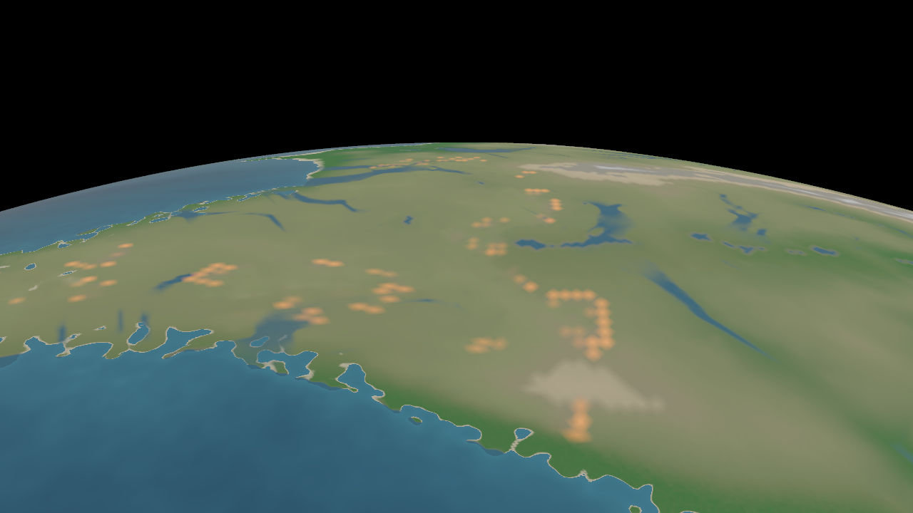

# 3d-world

A procedural 3D planet simulator tech demo in Rust: GPU-generated planets and living
ecosystems, rendered as photorealistically as we can manage.

Built on [Bevy](https://bevy.org) 0.20 (wgpu, Vulkan backend). The heavy lifting is GPU
compute: each simulation subsystem is a set of compute passes over planet-wide fields.


| low orbit | eye height |
|---|---|
|  |  |

## Status

- Step 1: the app skeleton and a reusable GPU simulation framework, with a procedural
  heightfield and thermal erosion.
- Step 2: hydraulic erosion. Rain, pipe-model water flow, sediment transport, erosion and
  deposition carve drainage networks, lakes and deltas.
- Step 3: planet generation bake. Terrain and erosion run once, offline, as a generate
  phase; then static moisture, temperature and biome maps are derived. The result is saved
  to a disk cache and later starts load it and run no geology (screenshot: seed 7, 3000
  generation steps at 512²).

- Step 4: live plant ecosystem. Grass, shrubs and trees grow, shade each other, spread and
  burn in wildfires, on top of the baked planet (screenshot: 600 live steps).

- Step 5: level-of-detail terrain. A quadtree of chunks per cube face streams in detail
  around the camera, from the whole planet down to eye height, with a floating origin.

There is no climate simulation and no seasons: the environment maps are static.

Next: atmosphere and ocean, vegetation and animal rendering, animals.

## Running

```sh
cargo run --release                  # window (controls below)
cargo run --release -- --help        # options
cargo run --release -- --headless --out out  # no window: writes out/planet.png
cargo run --release -- --seed 3 --regenerate  # ignore the cached planet, generate again
```

Camera modes, switched with **1 / 2 / 3**:

- **1 Orbit** (default): **left-drag** moves over the planet, **right-drag** looks around,
  **scroll** changes altitude (from 20 planet radii down to eye height), **WASD** moves
  (**Shift** faster).
- **2 Fly**: free flight. **Left-click** captures the mouse for looking around (**Esc**
  releases it; **right-drag** also looks). **WASD** flies along the view, **E/Q** up and
  down, **Shift** faster, **scroll** sets the speed. Speed grows with height above the
  ground, from 15 m/s near it to hundreds of km/s in space.
- **3 Walk**: on foot at 1.7 m eye height, following the terrain (on the ocean, on its
  surface). Mouse look as in fly mode, **WASD** walks, **Shift** runs, **Space** jumps.

Other keys: **Space** (or **P**; only **P** while walking) pauses the simulation, **R**
generates a new planet (next seed), **Up/Down** live simulation steps per frame.

The first start with a given seed and resolution generates the planet
(`--generation-steps`, default 3000) and writes it to `cache/planet-v1-seed<seed>-res<res>.bin`
(about 36 MiB at 512²). Later starts load that file in well under a second. `--no-cache`
turns the cache off, `--cache DIR` moves it.

Headless mode renders offscreen and saves three views, `planet.png` (whole planet),
`orbit.png` (low orbit) and `surface.png` (40 m above hilly land near the middle of the first
view), each once its terrain detail has streamed in, plus `stats.txt` (min/max/mean of every
field and plant layer, and the share of each biome), and exits. `--steps N` runs N
live steps first. It works on a software Vulkan
driver (Mesa lavapipe), which is what CI uses; generating at 512² takes about 8 minutes there.

## Layout

```
src/sim/          GPU simulation framework (reusable, knows nothing about planets)
  mod.rs          fields, passes, controls, the main-world API
  render.rs       render-world side: pipelines, bind groups, dispatch, double buffering
  cache.rs        baked fields on the CPU, disk cache
src/planet/       the planet: declares fields + passes, renders from them
  mod.rs          TerrainParams, PlanetMaterial, the simulation declaration
  mesh.rs         cube-sphere mesh (same face convention as the shaders)
  surface.rs      CPU surface: bicubic baked height + procedural detail, in f64
  lod.rs          quadtree LOD terrain chunks
  camera.rs       planet camera (f64) and floating origin
assets/shaders/
  sim/common.wesl         globals, cube-sphere addressing, cross-face neighbours, noise
  planet/terrain_*.wesl   terrain passes
  planet/hydro_*.wesl     hydraulic erosion passes
  planet/moisture_spread.wesl, generation_finalize.wesl   environment maps + biomes
  planet/plants_*.wesl, fire_spread.wesl                  live plant ecosystem
  planet/planet_material.wesl   displaces + shades the planet from the height field
```

## The simulation framework

Planet state lives in **fields**: cube-sphere texture arrays with 6 layers (one per cube face)
of `resolution × resolution` texels. A **pass** is a compute entry point that reads some
fields and writes others. A subsystem is declared in a few lines:

```rust
graph
    .add_field(HEIGHT, FieldFormat::R32Float)
    .add_pass(
        SimPass::new("terrain_init", "shaders/planet/terrain_init.wesl", "terrain_init")
            .write(HEIGHT)
            .trigger(PassTrigger::OnReset)
            .with_params(params),
    )
    .add_pass(
        SimPass::new("terrain_relax", "shaders/planet/terrain_relax.wesl", "terrain_relax")
            .read(HEIGHT)
            .write(HEIGHT)          // read + write => framework double-buffers it
            .with_params(params),
    );
```

The framework allocates the textures, builds bind group layouts and bind groups from the
declaration, compiles pipelines (and waits for all of them before the first step), runs passes
in order each step, double-buffers fields a pass both reads and writes, uploads per-step
globals and per-pass params, and handles reset and pause.

Shader contract, all in `@group(0)`:

| binding | contents |
|---|---|
| 0 | `globals: SimGlobals` (resolution, step, seed, dt, time) |
| 1 | `params`: the pass's own uniform struct (`#[repr(C)]` + `bytemuck::Pod` on the Rust side) |
| 2.. | the pass's field bindings in declaration order: reads are `texture_2d_array<f32>` (use `textureLoad`), writes are `texture_storage_2d_array<FORMAT, write>` |

Dispatch is `@workgroup_size(8, 8, 1)` over `res × res × 6`, with `global_invocation_id.z` as
the cube face. `neighbor_texel` in `sim/common.wesl` steps across cube edges, so stencils
work seamlessly over the whole sphere.

### Generate, then live

Every pass belongs to a phase. **Generate** runs `SimPhase::Generate` passes for
`SimControl::generation_steps` steps, many steps per frame, then the
`PassTrigger::AfterGeneration` passes once. **Live** then runs `SimPhase::Live` passes for
the rest of the session. Fields marked with `SimGraph::bake` are read back and written to
the disk cache when generation finishes; a start that finds a valid file uploads it into the
field textures and goes straight to Live. Bump `GENERATOR_VERSION` in `src/planet/mod.rs`
whenever generation changes, so old planets are not loaded.

The planet's generate phase is terrain + hydraulic erosion + moisture spreading. Its live
phase is the plant ecosystem. `PassTrigger::OnReset` passes run at step 0 of their own phase,
so live state is initialised whether the planet was generated or loaded.

### Environment maps

- `moisture` (0..1): spreads inland from oceans, lakes and rivers, decaying with distance
  and with every climb over high ground, so ranges cast rain shadows. It also scales
  rainfall during erosion, so wet coasts carve more than dry interiors.
- `temperature` (°C, `generation_finalize`): warm equator, cold poles, 6.5 °C/km lapse rate.
- `biome`: from temperature and precipitation (moisture, dried in the subtropical belt):
  ocean, lake, ice, tundra, desert, boreal and temperate forest, grassland, shrubland,
  savanna, tropical forest. The planet material colours land by biome, with beaches, bare
  rock on steep slopes and snow from temperature.

### Plant ecosystem

Live fields: `plants` (rgba: grass, shrub and tree cover 0..1, plus fuel, the dead litter
fires burn) and `fire` (intensity burning this step). One live step is roughly a month.

1. `plants_init` (step 0): a sparse, patchy first cover wherever each type can grow.
2. `plants_grow`: each type grows logistically toward a carrying capacity set by temperature
   and precipitation. Trees shade shrubs and grass, shrubs shade grass, so forests take over
   where it is wet enough. Bare land is colonised from neighbouring cover. Living cover drops
   litter, which decomposes faster when wet. Fires remove cover (grass most, trees least)
   and all fuel.
3. `fire_spread`: lightning ignites texels at random, and burning texels ignite neighbours,
   both in proportion to flammability (fuel, dryness, warmth). A burnt texel has no fuel, so
   fires leave firebreaks and burn out; in dry grassland and savanna they recur and keep
   the land open, in wet forest they hardly start.

Constants are in `PlantParams`. The planet material draws bare ground by biome, then grass,
shrubs and trees by cover, and fires as an emissive glow.

### Level-of-detail terrain

While the planet generates, a GPU-displaced sphere previews the live height field. Once it
is baked, the baked fields are copied to the CPU and the planet is drawn as LOD terrain:

- **Surface** (`surface.rs`): the baked height (~20 km texels, sampled bicubically across
  cube edges) plus fractal detail from 40 km down to the mesh spacing, rougher and ridged in
  mountains, gentler in lowlands. Everything is f64.
- **Quadtree** (`lod.rs`): each cube face is a quadtree of 32×32-quad chunks, up to level 19
  (~0.3 m between vertices). A chunk splits when the camera is nearer than 2.4 edge lengths;
  chunks wholly behind the horizon are skipped. Chunks are built on the async compute pool,
  nearest first, with positions relative to the chunk centre. A chunk is replaced by its
  children only once all four are built, so there are never holes; skirts cover cracks
  between levels.
- **Floating origin** (`camera.rs`): the camera's position is kept in f64, the render camera
  sits at the origin, and every chunk is placed at `centre − camera` each frame, so f32
  precision is never a problem, from 20 radii out to 1.8 m above the ground.
- **Shading**: the same field-driven colours as before; up close, noise breaks the 20 km
  plant cover into groves and clearings, and octaves smaller than a few pixels fade out.

### Hydraulic erosion

Fields: `water` (depth, m), `sediment` (suspended, m of rock), `flux` (outflow to the 4
neighbours, rgba), `discharge` (smoothed inflow, high along rivers). Per step:

1. `hydro_flux`: pipe model (Mei et al. 2007). Outflow grows with the water-surface
   difference to each neighbour and is scaled so a cell never sends more than it holds.
2. `hydro_water`: apply fluxes, move sediment with the same fractions as water, add rain,
   evaporate; oceans hold their surface at sea level and act as the sink.
3. `hydro_erode`: sediment capacity = `capacity × discharge × slope`. Below it the water
   digs (never below the lowest neighbour), above it drops sediment.

Material only moves between `height` and `sediment`, so their sum is conserved (drift
~0.001 m over 3000 steps from float rounding); `generation_finalize` settles the remaining
sediment back onto the terrain. Fluxes are stored in
each cell's own face frame, and `reverse_direction` in `common.wesl` finds the matching slot
across rotated cube faces, so rivers cross face edges seamlessly. Constants live in
`HydroParams` and are tuned for geological time at planet scale, not real-world units.

### Single queue

wgpu exposes one queue, so simulation and rendering share every frame's GPU time.
`SimControl::steps_per_frame` is the live time-slicing knob; generation instead uses
`generation_steps_per_frame` and gives up frame rate to finish quickly.

### Cube-sphere convention

Face `f` has axes `(N, U, V)` (see `FACE_AXES` in `src/planet/mesh.rs` and
`face_normal/face_u/face_v` in `common.wesl`; they must agree). Texel `(x, y)` maps to
`s = (x + 0.5) / res * 2 - 1`, then an equal-angle warp `a = tan(s · π/4)`, then
`dir = normalize(N + a·U + b·V)`. Texel areas vary by about 1.4× across a face.

## Licence

MIT
